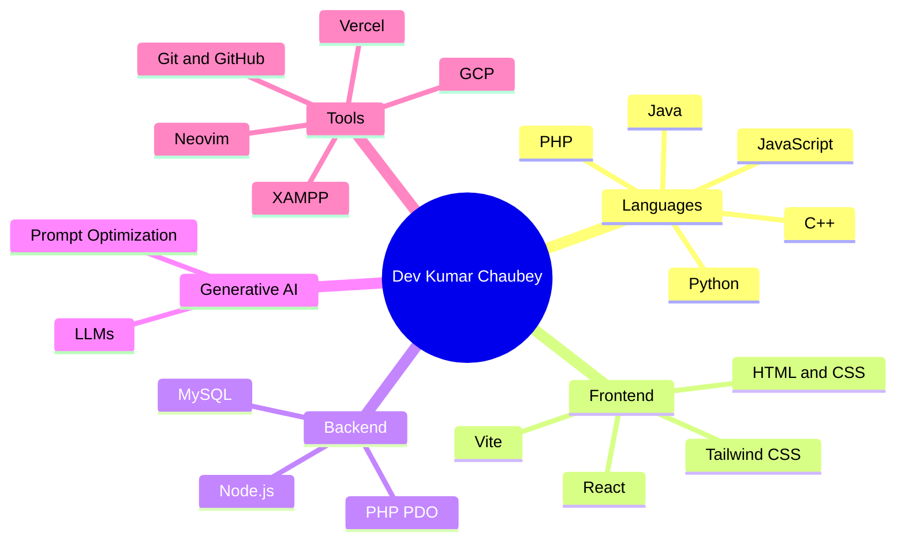

<!-- ============================================================
  Username set to: vash57
  Still to replace: YOUR_LINKEDIN_ID, YOUR_EMAIL@example.com, YOUR_PORTFOLIO_URL,
  YOUR_TWITTER_HANDLE, ENVIRONMENTAL_GAME_REPO, PORTFOLIO_REPO

  Optional: add snake.yml to .github/workflows/ in the vash57/vash57 repo,
  run it once, then uncomment the SNAKE block near the bottom.
============================================================ -->

<!-- ===================== WAVE HEADER (animated) ===================== -->
<p align="center">
  
</p>

<!-- ===================== MAIN TYPING SVG ===================== -->
<p align="center">
  <a href="https://github.com/vash57">
    
  </a>
</p>

<!-- ===================== PROFILE METRICS ===================== -->
<p align="center">
  
  <a href="https://github.com/vash57?tab=followers">
    
  </a>
</p>

<p align="center">
  
  
  
</p>

<!-- ===================== SOCIAL LINKS ===================== -->
<!-- 🔗 Replace each href with your real profile links -->
<p align="center">
  <a href="https://www.linkedin.com/in/YOUR_LINKEDIN_ID"></a>
  <a href="mailto:YOUR_EMAIL@example.com"></a>
  <a href="https://YOUR_PORTFOLIO_URL.vercel.app"></a>
  <a href="https://twitter.com/YOUR_TWITTER_HANDLE"></a>
</p>

<p align="center">
  
</p>

<!-- ===================== ABOUT ME ===================== -->
<p align="center">
  
</p>

<table align="center">
  <tr>
    <td>

```js
const dev = {
  name: "Dev Kumar Chaubey",
  education: "B.Tech CSE @ Siddhartha Institute of Engineering & Technology (SIET)",
  focus: ["Backend Development", "Web Applications", "Problem Solving"],
  internships: ["Generative AI (LLMs & Prompt Optimization)", "Java Development"],
  achievements: ["🥈 2nd Place (College Level) — Smart India Hackathon"],
  hobbies: ["Cricket 🏏", "Outdoor Adventures 🏕️", "Music 🎵"],
  currentlyLearning: ["Advanced LLM workflows", "Scalable backend design"],
  status: "Open to internships, collaborations & hackathon teams",
  funFact: "I debug code the way I play cricket — patiently, and always going for the big hit. 🚀"
};
```

  </td>
  </tr>
</table>

<p align="center">
  
</p>

<br/>

<!-- ===================== HIGHLIGHTS ===================== -->
<p align="center">
  
</p>

<div align="center">
<table>
  <tr>
    <td align="center" width="33%">
      <h3>🥈 Smart India Hackathon</h3>
      <sub><b>2nd Position</b> at College Level</sub>
    </td>
    <td align="center" width="33%">
      <h3>🤖 Generative AI Intern</h3>
      <sub>LLMs & Prompt Optimization</sub>
    </td>
    <td align="center" width="33%">
      <h3>☕ Java Intern</h3>
      <sub>Hands-on industry experience</sub>
    </td>
  </tr>
</table>
</div>

<br/>

<!-- ===================== TECH STACK ===================== -->
<p align="center">
  
</p>

<div align="center">
<table>
  <tr>
    <td align="center">
      <h4>💻 Languages</h4>
      
    </td>
    <td align="center">
      <h4>🎨 Frontend</h4>
      
    </td>
  </tr>
  <tr>
    <td align="center">
      <h4>⚙️ Backend & Databases</h4>
      
      <br/>
      
    </td>
    <td align="center">
      <h4>🧰 Tools & Platforms</h4>
      
      <br/>
      
    </td>
  </tr>
</table>
</div>

<br/>

<!-- ===================== SKILLS MAP (Mermaid, renders natively on GitHub) ===================== -->
<p align="center">
  
</p>



<br/>

<!-- ===================== FEATURED PROJECTS ===================== -->
<p align="center">
  
</p>

<!-- 🔗 Replace ENVIRONMENTAL_GAME_REPO and PORTFOLIO_REPO with your actual repo names; confirm HeritageHub matches your repo name exactly -->
<div align="center">
<table>
  <tr>
    <td align="center" width="33%" valign="top">
      <a href="https://github.com/vash57/HeritageHub">
        
      </a>
      <br/>
      <sub>🏛️ <b>HeritageHub</b> — College Management System + Indian Cultural Traditions showcase</sub>
      <br/><br/>
      
      
      
    </td>
    <td align="center" width="33%" valign="top">
      <a href="https://github.com/vash57/ENVIRONMENTAL_GAME_REPO">
        
      </a>
      <br/>
      <sub>🌱 <b>Environmental Game</b> — Interactive web app promoting eco-awareness</sub>
      <br/><br/>
      
      
      
    </td>
    <td align="center" width="33%" valign="top">
      <a href="https://github.com/vash57/PORTFOLIO_REPO">
        
      </a>
      <br/>
      <sub>🌐 <b>Personal Portfolio</b> — React + Tailwind CSS, deployed on Vercel</sub>
      <br/><br/>
      
      
      
    </td>
  </tr>
</table>
</div>

<p align="center">
  <!-- 🔗 Replace with your live portfolio URL -->
  <a href="https://YOUR_PORTFOLIO_URL.vercel.app">
    
  </a>
</p>

<br/>

<!-- ===================== GITHUB ANALYTICS ===================== -->
<p align="center">
  
</p>

<div align="center">
<table>
  <tr>
    <td valign="top">
      
    </td>
    <td valign="top">
      
    </td>
  </tr>
</table>
</div>

<p align="center">
  
</p>

<!-- ===================== ACTIVITY GRAPH (draws itself) ===================== -->
<p align="center">
  
</p>

<!-- ===================== TROPHIES ===================== -->
<p align="center">
  
</p>

<p align="center">
  
</p>

<!-- ===================== SNAKE ANIMATION (OPTIONAL) =====================
  🐍 Setup:
  1. Put snake.yml in .github/workflows/ of the vash57/vash57 repo.
  2. Actions tab → "Generate Snake Animation" → Run workflow (once).
  3. Uncomment the block below.

<p align="center">
  <picture>
    <source media="(prefers-color-scheme: dark)" srcset="https://raw.githubusercontent.com/vash57/vash57/output/github-snake-dark.svg" />
    <source media="(prefers-color-scheme: light)" srcset="https://raw.githubusercontent.com/vash57/vash57/output/github-snake.svg" />
    
  </picture>
</p>
-->

<br/>

<!-- ===================== INTERESTS ===================== -->
<p align="center">
  
</p>

<p align="center">
  
  
  
</p>

<!-- ===================== QUOTE ===================== -->
<p align="center">
  
</p>

<p align="center">
  
</p>

<!-- ===================== CONNECT CTA ===================== -->
<p align="center">
  
</p>

<p align="center">
  
</p>

<!-- ===================== WAVE FOOTER (animated) ===================== -->
<p align="center">
  
</p>
